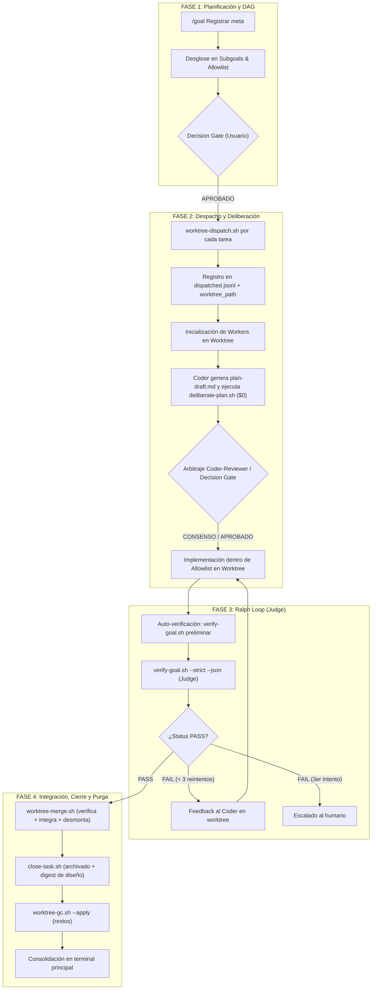

# parallel-orchestration

> Ejecutar bajo el rol **Coordinator** en la terminal principal de {{PROJECT_NAME}}.
> Requisito previo: leer `.agents/workflows/session-start.md` (la sesión registra
> en el lock el worktree donde trabaja) y `.agents/workflows/session-close.md`
> (cerrar no integra ni borra: ver §3b).

## Objetivo

- Coordinar la ejecución paralela de múltiples tareas técnicas mediante agentes especialistas (`coder`, `qa-judge`, `docs-researcher`).
- Garantizar el aislamiento estricto de cada agente en su propio Git Worktree efímero **hermano al checkout** (`<padre>/<repo>-<task-id>/`), fuera del árbol.
- Aplicar compuertas de calidad deterministas a 0 tokens (`verify-goal.sh`) y el bucle de validación independiente **Ralph Loop**.
- Preservar la higiene del repositorio y del sistema purgando los worktrees tras su integración (ADR 004) y sin borrar nunca trabajo sucio.

## Ubicación canónica (T-107)

```
<repo>/                  ← checkout principal: punto de integración, en la base
<repo>-<task-id>/        ← worktree efímero del worker, fuera del árbol
```

- El checkout principal **no se edita**: es donde se revisa, se integra y se publica.
- Cada worktree lleva su rama efímera `feat/<task-id>-<profile>`. Una rama, un worktree, un agente.
- El default lo implementan `worktree-dispatch.sh`, `worktree-merge.sh` y `dispatch-satellite.sh` (vía `worktree_base`): no se escribe a mano, se lee del campo `worktree_path` del JSON que emite el dispatch.
- Excepción: Orca decide sus propias ubicaciones (`new-top-level`/`new-child`); el core documenta el mapeo y no lucha contra el runtime.

## Perímetro y Restricciones de Cómputo (ADR 004)

> ⚠️ **RESTRICCIÓN CRÍTICA DE ALMACENAMIENTO Y HOSTS**:
>
> 1. **Gate programático de disco**: `worktree-dispatch.sh` rehúsa despachar si el
>    destino tiene menos de `WORKTREE_MIN_FREE_GB` (default 5 GB) libres. Sin
>    espacio no hay despacho; no es un aviso, es un error accionable.
> 2. **Hosts autorizados para paralelismo**: worktrees concurrentes solo en el
>    entorno local (`<control-node>`) o nodos worker con >20 GB declarados en
>    `.agents/config/fleet.yaml`. **Prohibido** aprovisionar lotes en nodos de
>    infraestructura (`<infra-node>`).
> 3. **Limpieza**: todo worktree integrado se desmonta (`remove --force` + `prune`
>    + borrado de la rama efímera). Los restos se purgan con `worktree-gc.sh --apply`,
>    que nunca toca el principal, bloqueados ni sucios.

## Archivos y Rutas a Revisar

- `templates/goals/goal.schema.md`
- `.agents/tasks/`
- `.agents/context/dispatched.jsonl` (registro append-only de lo despachado)
- `scripts/agent/worktree-dispatch.sh`
- `scripts/agent/deliberate-plan.sh`
- `scripts/agent/design-digest.sh`
- `scripts/agent/verify-goal.sh`
- `scripts/agent/worktree-merge.sh`
- `scripts/agent/worktree-gc.sh`

---

## Protocolo Operativo en 4 Fases



> El estado del lote **emerge de los registros** (`dispatched.jsonl`, `git worktree
> list`, el propio JSON de cada script). No existe `dag-state.json`: se documentó
> y nunca se usó; no se resucita.

---

### FASE 1 — Desglose

1. **Recepción de la Meta**: el Coordinator define el End State Contract en `templates/goals/goal.schema.md`.
2. **Submetas y Allowlist**: por cada subtarea, su task file en `.agents/tasks/task-<ID>.md` con la **Caja de Archivos Autorizados**.
3. **Decision Gate Obligatorio (Fase 3.5)**: plan consolidado en la terminal principal; `APROBADO` explícito antes de tocar el sistema de archivos.

---

### FASE 2 — Despacho Concurrente y Deliberación en Worktrees Aislados

Por cada nodo independiente del DAG:

1. **Aprovisionamiento**:
   ```bash
   bash scripts/agent/worktree-dispatch.sh --task-id <TASK_ID> --profile <PROFILE> --base <TARGET_BRANCH> --json
   ```
   Sin `--path`: aterriza en `<padre>/<repo>-<TASK_ID>/`. El gate de disco puede rehusar aquí.
2. **Registro y Trazabilidad**: el comando anexa automáticamente la entrada con estado inicial `deliberation: PENDING` a `.agents/context/dispatched.jsonl`, y emite el contrato JSON con la ruta `worktree_path`.
3. **Puesta en marcha e Inyección**: el worker trabaja dentro de ese directorio, aislado. Carga el arnés con:
   ```bash
   source <worktree>/.agents/context/worktree.env
   ```
   El entorno exporta `AGENT_OS_ROOT`, `AGENT_OS_TASK_ID`, `AGENT_OS_WORKTREE_PATH` y `AGENT_OS_DELIBERATION_FILE`.
4. **Bucle de Deliberación ($0 tokens)**:
   - Antes de modificar código, el Coder redacta `.agents/context/plan-draft.md` dentro de su worktree con el análisis DRY y la propuesta técnica acotada a la allowlist.
   - Ejecuta el motor determinista de arbitraje:
     ```bash
     bash "$AGENT_OS_ROOT/scripts/agent/deliberate-plan.sh" --task-id <TASK_ID> --plan .agents/context/plan-draft.md
     ```
   - El resultado se persiste en `.agents/context/deliberation-${TASK_ID}.json`. Solo tras obtener veredicto favorable (`CONSENSO` o aprobación en Decision Gate) procede con la implementación en la allowlist.
5. **Auto-verificación preventiva**:
   - Tras completar los cambios y antes de notificar la entrega, el Coder valida localmente:
     ```bash
     bash "$AGENT_OS_ROOT/scripts/agent/verify-goal.sh" --task-id <TASK_ID> --allow-dirty --json
     ```

---

### FASE 3 — Evaluación Independiente (Ralph Loop / Circuit Breaker)

1. **Invocación del Judge**:
   ```bash
   bash "$AGENT_OS_ROOT/scripts/agent/verify-goal.sh" --task-id <TASK_ID> --base <TARGET_BRANCH> --strict --json
   ```
   (ejecutado con cwd en el worktree del worker).
2. **Veredicto**:
   - `PASS` → Fase 4.
   - `FAIL` (< 3 reintentos) → violaciones al worker para autocorrección en su worktree.
   - `FAIL` (3er intento, Circuit Breaker) → trabajo suspendido, escalado al humano.

---

### FASE 4 — Integración Segura, Desmontaje y Purga (ADR 004)

1. **Merge y desmontaje** (requiere PASS salvo `--skip-verify` explícito):
   ```bash
   bash scripts/agent/worktree-merge.sh --task-id <TASK_ID> --target <TARGET_BRANCH> --json
   ```
   Revalida, integra (`--ff-only` por defecto), `git worktree remove --force`, `prune`, borra la rama efímera.
2. **Cierre Formal y Digest**:
   ```bash
   bash scripts/agent/close-task.sh <TASK_ID>
   ```
   Archiva el task file y genera el Executive Design Digest leyendo la deliberación persistida.
3. **Purga de restos**:
   ```bash
   bash scripts/agent/worktree-gc.sh --apply
   ```
   Solo huérfanos. Lo sucio y lo bloqueado se queda.
4. **Publicación (si procede)**: `promote-to-main.sh --source <RAMA>` integra en `main` con push opcional (gate humano). **No desmonta worktrees**: es publicación, no limpieza. Ver `session-close.md` §3b para cuándo usar cada uno.
