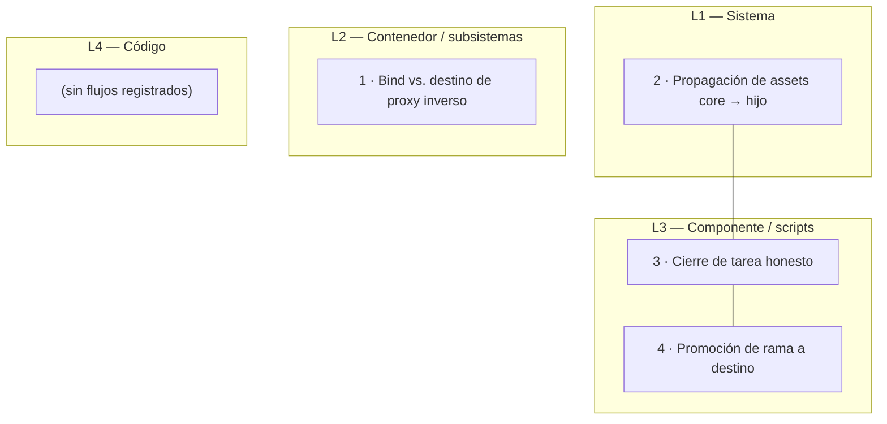

# Mapa de flujos — Agent OS Core

> 🔒 **GENERADO AUTOMÁTICAMENTE — NO EDITAR A MANO.**
> Fuente única: [`docs/critical-flows.md`](critical-flows.md). Regenerar con:
> `bash scripts/agent/generate-flow-map.sh`
>
> El mapa no es una fuente independiente: es una proyección de la fuente. Si algo aquí
> no cuadra con `critical-flows.md`, **la fuente es lo que vale** y el mapa está
> desactualizado. El check 21 de la suite falla mientras eso siga siendo cierto.

## Niveles C4 adaptados

Los nombres C4 se conservan; lo que se define aquí es qué representa cada nivel en un
core bash (scripts, worktrees y assets), para que la columna no sea decorativa.

- **L1 — Sistema** — La relación entre el core y cada proyecto hijo. Lo que cruza la frontera del repositorio.
- **L2 — Contenedor / subsistemas** — Un conjunto de procesos que se despliegan y fallan juntos (servicio + proxy inverso, nodo de la flota).
- **L3 — Componente / scripts** — Un script del core y los que invoca, con su contrato de entrada/salida.
- **L4 — Código** — Funciones internas de un script. **Opcional**: un flujo que solo se rompe dentro de una función no suele dar señal clara, así que este nivel se reserva y hoy está vacío a propósito.

## Diagrama

## Registro de flujos

| # | Flujo | Nivel | Riesgo principal | Cobertura | Última tarea |
| :-- | :--- | :--- | :--- | :--: | :--- |
| 1 | Bind vs. destino de proxy inverso | L2 | El servicio escucha en una dirección y el proxy inverso apunta a otra: el proxy responde error de gateway aunque el backend esté sano y el healthcheck en verde. | 🟡 | T-098 |
| 2 | Propagación de assets core → hijo | L1 | El hijo recibe los scripts pero no las librerías nuevas: sus scripts de cierre mueren al hacer `source` de un fichero inexistente, y el fallo aparece como error de shell, no como "no estás al día". | ⬜ | T-101 |
| 3 | Cierre de tarea honesto | L3 | El script anunciaba "✅ cerrada" sin comprobar que el enlace del sprint apuntara al task file archivado, y el commit de sprint salía con `0 insertions` dejando cambios sin commitear. | 🟡 | T-100 |
| 4 | Promoción de rama a destino | L3 | Con `--ff-only` cableado, promover una rama con commits propios fallaba por un motivo que no explicaba la causa real; y `--push --pr` abría un PR vacío porque el destino ya contenía la rama. | 🟡 | T-101 |

## Relaciones

| Desde | Hacia | Mecanismo |
| :-- | :-- | :--- |
| 3 | 4 | El commit que produce el cierre de tarea es exactamente el que `promote-to-main.sh` promueve después. Un cierre que miente deja además la promoción sin nada que integrar. |
| 2 | 3 | Un hijo que no recibió las librerías nuevas no puede ejecutar el cierre que el core acaba de endurecer. |

---

## Sobre este mapa

- **Una sola fuente**: `docs/critical-flows.md`. Este fichero es una proyección suya.
- **Sin literales de infraestructura**: por política de la fuente, el mapa no contiene IPs,
  dominios ni hostnames. `docs/architecture/control-plane-topology.md` sí los contiene y
  **no se lee** para generar este mapa; su incumplimiento está anotado en `roadmap.md`.
- **Sin build**: el diagrama es Mermaid, que GitHub renderiza dentro de este mismo `.md`.
- **Vista para agentes**: [`flow-map.digest.md`](flow-map.digest.md), plana y acotada.
