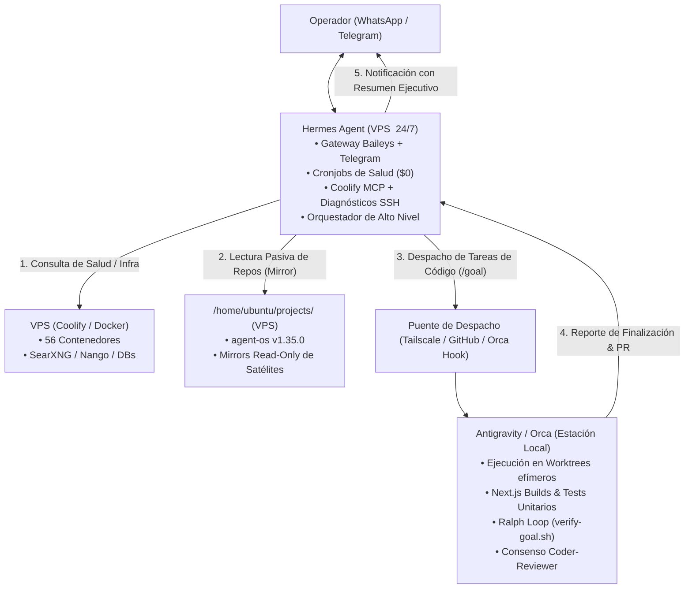

# Investigación Técnica y Diagnóstico Empírico: Hermes Agent como Hub Móvil 24/7 y Orquestador de Flota (Sprint 40)

> **Fecha**: 13 de Noviembre de 2026  
> **Estado**: Propuesta de Sprint para Validación  
> **Ámbito**: Infraestructura de Flota (Nodo `<nodo-inferencia>`, Nodo `<nodo-orquestacion>`, Estación Local) y Orquestación Multi-Agente

---

## 1. Resumen Ejecutivo

El objetivo de este sprint es transformar a **Hermes Agent** (desplegado 24/7 en el VPS `<nodo-inferencia>`) en el **punto de entrada unificado y asistente omnipresente** del operador vía WhatsApp y Telegram. Desde cualquier lugar, el operador podrá pedirle cualquier tarea, consultar el estado de la infraestructura o solicitar cambios en un repositorio; Hermes sabrá a quién delegar (especialmente a **Antigravity** como motor de ingeniería para tareas de desarrollo profundo), y ejecutará **cronjobs periódicos** para vigilar la salud de los servicios y entregar resúmenes o alertas proactivas sin quemar tokens innecesarios.

Esta investigación se fundamenta en un **diagnóstico empírico en vivo** de los dos servidores VPS de la flota (`<nodo-inferencia>` y `<nodo-orquestacion>`), contrastado con el estado del arte de la comunidad OSS y las capacidades del runtime de Hermes.

---

## 2. Diagnóstico Empírico de los Nodos de la Flota (Datos Reales)

### 2.1. Nodo de Inferencia y Datos: `<nodo-inferencia>` (`<ip-nodo-inferencia>` / `<interfaz-nodo-inferencia>`)

| Parámetro | Valor Medido en Vivo | Evaluación |
|---|---|---|
| **Sistema Operativo** | Ubuntu 22.04 LTS (aarch64) | Soporte completo |
| **Recursos Hardware** | 24 GB RAM (17 GB libres), 194 GB Disco (131 GB libres, 33% uso) | Capacidad sobrante para clonar repositorios y herramientas |
| **Procesos Hermes Activos** | • `hermes-gateway.service` (PID 3128185) • `hermes-dashboard.service` (puerto 9119) • `rag-service.service` • `whatsapp-groups-watcher.service` • `whatsapp-bridge` (puerto 3001) | Hermes corre como daemon continuo bajo systemd de usuario |
| **Canales de Mensajería** | • Telegram DM (ID `529841983` - Romén) • WhatsApp DM (`@lid` de Romén) y 2 grupos autorizados | Totalmente operativo para recibir órdenes y enviar respuestas |
| **Inferencia de Hermes** | OmniRoute en `http://<ip-nodo-inferencia>:20128/v1` (`auto/best-coding`) | Coste $0 tokens, enrutamiento local a múltiples proveedores |
| **MCPs Configurados en Hermes** | • `coolify-mcp` (`https://coolify.romensuarez.com`) con token activo • `airtable` MCP server | Hermes ya tiene integración nativa para consultar Coolify |
| **Plugins Activos** | `orca-status` (reporta hooks de ciclo de vida a Orca) | Integración previa existente con el entorno Orca |
| **Estado de Agent OS en Hermes** | `~/.hermes/skills/agent-os` apunta mediante symlinks a `/home/ubuntu/projects/agent-os` en rama `experiment/hermes-integration` (commit `1d8bd23`, 11 de Julio de 2026) | **DESFASADO**: Solo tiene 16 skills viejas. Faltan 15 skills modernas del core `v1.35.0` (`coolify-admin`, `remote-admin`, `orchestrator`, `infisical-secrets`, `web-compliance`, etc.) |
| **Subsistema Cron** | Motor nativo en `~/.hermes/cron/jobs.json` con SQLite | **HALLAZGO**: 1 job semanal activo («Newsletter Weekly Audit») fallando por modelo no válido (`llama3.1:8b` en vez de endpoint OmniRoute) |
| **Conectividad de Red** | • Hacia `<nodo-orquestacion>`: SSH directo sin clave funcionando (`ssh <nodo-orquestacion>-ts` -> `<interfaz-nodo-orquestacion>`). • Hacia Local: Ping Tailscale responde; puerto 6768 (Orca IDE) ABIERTO y devuelve HTTP 200 OK. Puerto 22 cerrado. | Conectividad privada segura garantizada por Tailscale |

### 2.2. Nodo PaaS y Despliegues: `<nodo-orquestacion>` (`<ip-nodo-orquestacion>` / `<interfaz-nodo-orquestacion>`)

| Parámetro | Valor Medido en Vivo | Evaluación |
|---|---|---|
| **Sistema Operativo** | Ubuntu 24.04 LTS (aarch64) | Compatible |
| **Recursos Hardware** | 24 GB RAM (8.1 GB libres), 193 GB Disco (107 GB libres, 45% uso) | Buen margen operativo |
| **Docker / Coolify** | 56 contenedores activos (Coolify, SearXNG, Nango, Umami, PostgreSQL, Sentinel, etc.) | La mayor parte de la infraestructura de aplicaciones corre aquí |
| **Repositorios en Disco** | `/home/ubuntu/projects/hermes-vps-config` únicamente | El código de aplicaciones vive en volúmenes de Coolify (`/data/coolify/applications`) |

### 2.3. Estación de Trabajo Local: `<host-local>` (`<ip-host-local>`)

| Parámetro | Valor Medido en Vivo | Evaluación |
|---|---|---|
| **Repositorios de Código** | 28 proyectos en `~/Proyectos/` (`agent-os`, `annascheer-web`, `kanarii`, `polymarket`, `surf-app`, `ops-hub`, etc.) | Fuente principal del código activo y desarrollo |
| **Herramientas de Agentes** | Antigravity CLI (`~/.local/bin/agy`), Orca ADE (puerto 6768), Node 20+, Git Worktrees | Motor de desarrollo e ingeniería profunda |

---

## 3. Arquitectura y Análisis de Trade-offs: El Rol de Hermes vs Antigravity

### 3.1. Separación de Responsabilidades: "Front-Door Omnipresente" vs "Deep Engineering Worker"

La comunidad de agentes autónomos y las mejores prácticas en sistemas multi-agente distribuidos (patrones de AutoGen, CrewAI y Nous Research) demuestran que intentar convertir al agente de mensajería móvil en el compilador y editor de código masivo genera graves fricciones (conflictos de Git, lentitud en chats móviles, falta de herramientas de testing en el servidor, builds costosos).

Proponemos una arquitectura desacoplada en dos roles complementarios:

1. **Hermes (El Asistente Front-Door 24/7 en VPS):**
   - Siempre accesible en tu bolsillo (WhatsApp / Telegram).
   - Conoce toda la flota (vía SSH a `<nodo-orquestacion>`, MCP de Coolify, Glances, OmniRoute).
   - Puede responder preguntas inmediatas sobre el estado de la infra, logs de contenedores o salud de servicios.
   - Ejecuta cronjobs periódicos de vigilancia y avisa proactivamente si algo falla.
   - Cuando le pides una tarea de desarrollo ("*Añade el banner de cookies a surf-app y sube el PR*"), **no intenta compilar 30 páginas de Next.js en el chat**, sino que formaliza el requerimiento, inicializa la tarea (`/goal`) y **despacha a Antigravity**.

2. **Antigravity (El Ingeniero de Software Principal en Local):**
   - Dispone del stack completo de desarrollo, librerías, emuladores y capacidad de compilación.
   - Aplica el estándar de Agent OS: crea worktrees efímeros (`scripts/agent/worktree-dispatch.sh`), delibera Coder-Reviewer, ejecuta `verify-goal.sh`, y deja la rama lista o el PR publicado.
   - Notifica a Hermes al concluir para que Hermes le informe al operador por WhatsApp.

---

## 4. Estrategia de Repositorios en el VPS (`<nodo-inferencia>`)

El usuario planteó: *"que tenga acceso a todo mi stack y repos, habrá que clonarlos en el vps supongo"*.

### 4. Estrategia de Repositorios en el VPS (`<nodo-inferencia>`): Enfoque Híbrido "Clones Mínimos + Repos Digest"

Tras la evaluación con el operador, se descarta clonar ciegamente los 28 repositorios en el VPS. Se adopta una estrategia mucho más eficiente y alineada con la filosofía de coste $0 de Agent OS:

1. **Clones con Working Tree Completo en el VPS (Solo para repos operativos en VPS)**:
   - Repositorios que tienen servicios o agentes ejecutándose en el propio servidor: `agent-os`, `hermes-vps-config`, `<nodo-inferencia>-stack`.
   - Si en el futuro un proyecto satélite requiere ejecución continua o soporte de agentes residentes en el VPS, se clona individualmente bajo demanda.

2. **Acceso Ligero vía Digest Estructurado (`generate-digest.sh`)**:
   - Para el resto de proyectos satélite (la gran mayoría que se desarrollan en local), no es necesario mantener 20 GB de código y `node_modules` en el VPS.
   - Hermes puede consumir el **digest estructurado** del repositorio generado por `scripts/agent/generate-digest.sh`.
   - **Ventaja de tokens y velocidad**: Para un LLM, procesar un digest único en texto plano con el mapa de arquitectura, rutas y exports es infinitamente más rápido y barato que navegar y leer docenas de archivos individuales por el filesystem.
   - Para consultas puntuales de archivos específicos, Hermes puede usar GitHub API / MCP GitHub sin clonar.

---

## 5. Diseño del Subsistema de Cronjobs de Observabilidad y Novedades

Hermes dispone de un motor cron nativo en `~/.hermes/cron/` con persistencia en `jobs.json` y entrega directa a Telegram o WhatsApp (`deliver: "whatsapp"` o `deliver: "telegram"`).

### 5.1. Reparación del Fallo Actual
El cronjob actual `Newsletter Weekly Audit` falla porque intenta invocar `llama3.1:8b` directamente. Se debe reconfigurar para usar el proveedor predeterminado `custom:omniroute` (`auto/best-coding`), garantizando coste $0 de tokens.

### 5.2. Nuevos Cronjobs Recomendados para la Flota (Canal Confirmado: WhatsApp Matutino)

El canal oficial acordado para las alertas de monitoreo es **WhatsApp**, aprovechando la integración existente con el bridge de Baileys. La política operativa será **Briefing Matutino + Alertas por Excepción**:

1. **Briefing Matutino ("Buenos Días Flota" — Diario 08:30 AM vía WhatsApp)**:
   - **Mecanismo**: Script Bash determinista que consulta la telemetría de memoria y disco de `<nodo-inferencia>` y `<nodo-orquestacion>-ts` vía SSH, más el estado de los contenedores de Coolify ($0 tokens).
   - **Formato**: Un mensaje compacto de WhatsApp con el resumen de salud de los 56 contenedores, URLs públicas y consumo de recursos.
2. **Alertas Inmediatas por Excepción (Solo si algo falla)**:
   - **Mecanismo**: Cronjob cada 1-2 horas verificando salud de URLs de producción y contenedores críticos de Docker/Coolify.
   - **Comportamiento**: Silencioso si todo está en orden (`HTTP 200/301` y containers en `running`). Dispara alerta urgente a WhatsApp únicamente si un servicio cae o entra en bucle de reinicio.

---

## 6. Integración del Ecosistema: Actualización Inmediata del Core en `<nodo-inferencia>`

El repositorio `/home/ubuntu/projects/agent-os` en `<nodo-inferencia>` data del 11 de Julio de 2026 y solo cuenta con 16 skills.
Para que Hermes sea un coordinador inteligente:
1. Sincronizaremos el clon de `agent-os` en `<nodo-inferencia>` a la versión `v1.35.0` (la release actual del core).
2. Hermes hereda de inmediato las **31 skills completas**, permitiéndole usar:
   - `remote-admin`: para ejecutar comandos SSH seguros en `<nodo-orquestacion>-ts`.
   - `coolify-admin`: para operar despliegues en Coolify.
   - `orchestrator`: para entender la gramática `/goal`, `/subgoal`, `/dispatch`.
   - `infisical-secrets`: para auditar o consultar variables centralizadas.
   - `web-compliance`: para auditar RGPD/cookies en satélites.

---

## 7. Preguntas de Decisión para Romén

Para enfocar y acotar el alcance del **Sprint 40**, necesitamos resolver las siguientes preguntas clave:

1. **Canal de Despacho Hermes -> Antigravity / Desarrollo Local**:
   - *(A) Vía GitHub (Asíncrono y Trazable)*: Cuando pidas una tarea de código por WhatsApp, Hermes crea un Issue o Rama en GitHub con el contrato `/goal`. Antigravity en local la detecta, ejecuta el trabajo en worktree efímero, valida los tests, y cuando está listo crea un PR que Hermes te avisa para aprobar por WhatsApp.
   - *(B) Vía API / Socket Directo por Tailscale*: Hermes invoca un endpoint local (mediante `agy remote-control` o el hook de Orca en puerto 6768) para despertar a Antigravity inmediatamente en tiempo real.
   - *(C) Híbrido*: Hermes puede hacer diagnósticos e inspecciones de código directamente en el VPS, pero para cualquier modificación o build pesado delega la ejecución a Antigravity.

2. **Alcance de los Repositorios a Clonar en el VPS**:
   - *(A) Repositorios Activos Clave*: Clonar solo los 6-8 proyectos con desarrollo continuo (`agent-os`, `annascheer-web`, `kanarii`, `polymarket`, `surf-app`, `ops-hub`, `romensuarez-web`) como réplicas de lectura.
   - *(B) Todos los 28 repos*: Clonar el listado completo de `~/Proyectos` en el VPS (aprox. 15-20 GB de disco).

3. **Canal Preferido para Alertas y Novedades de Cronjobs**:
   - *(A) WhatsApp*: Todo concentrado en el chat de WhatsApp (resúmenes matutinos + alertas de caídas).
   - *(B) Telegram para Monitoreo Técnico, WhatsApp para Conversación*: Separar alertas de infraestructura en el bot de Telegram y usar WhatsApp únicamente para tus conversaciones y órdenes directas.

4. **Frecuencia del Monitoreo Proactivo**:
   - *(A) Alertas por Excepción + Digest Diario*: Silencioso si todo va bien; solo envía un resumen a las 08:30 AM y te avisa inmediatamente si algún contenedor o web se cae.
   - *(B) Reportes Periódicos*: Reporte de estado cada 4 o 6 horas además de las alertas.

---

## 8. Propuesta de Tareas para el Sprint 40

| Tarea | Título | Descripción Técnica |
|---|---|---|
| **T-214** | Actualización y Sincronización del Core en `<nodo-inferencia>` | Llevar `/home/ubuntu/projects/agent-os` a `v1.35.0`, enlazar las 31 skills completas en `~/.hermes/skills/agent-os` y verificar permisos. |
| **T-215** | Aprovisionamiento de Repositorios Activos en el VPS | Clonar los proyectos principales en `/home/ubuntu/projects/` como espejos de inspección y configurar script de actualización periódica ($0 tokens). |
| **T-216** | Reparación y Despliegue del Subsistema de Cronjobs de Observabilidad | Corregir el snapshot de modelo en `~/.hermes/cron/jobs.json` (OmniRoute), e implementar cronjobs deterministas de salud para Coolify, Docker y URLs públicas. |
| **T-217** | Puente de Orquestación Hermes ↔ Antigravity (`/goal` dispatch) | Configurar el flujo para que peticiones de código en WhatsApp generen el contrato de meta y activen la ejecución de Antigravity en local con reporte de retorno. |
| **T-218** | Validación E2E Multi-Nodo de Flota | Prueba de extremo a extremo: Mensaje de WhatsApp pidiendo diagnóstico y orden de cambio -> Hermes delega -> Verificación -> Notificación de éxito. |
