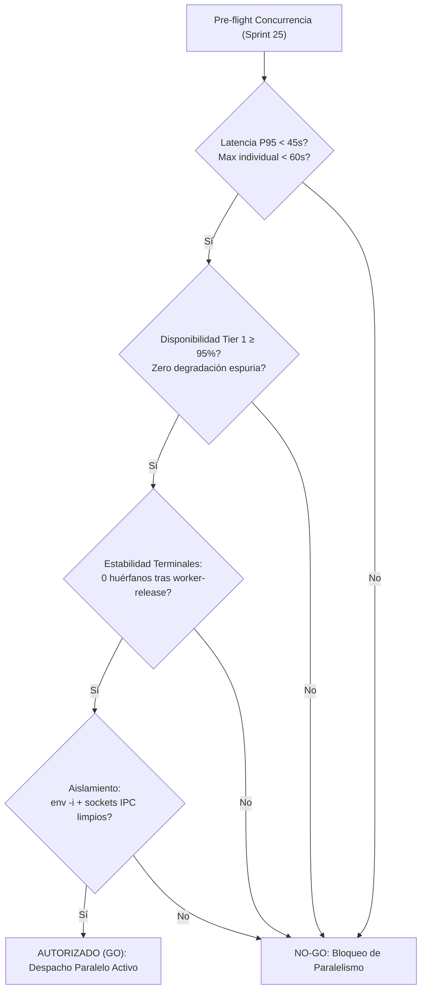

# Informe de Observación del Ciclo con Criterio de Paso al Paralelo (Sprint 24)

> **Estado**: Certificado y Consensuado en Host (Fase 3.5 T-140)  
> **Fecha**: 2026-10-30  
> **Ámbito**: Sprint 24 — Deliberación en Producción durante un Ciclo Completo con el Revisor Ejecutor Vivo  
> **Autores**: Antigravity Core Team & Revisor Ejecutor Orca ADE  

---

## 1. Resumen Ejecutivo

El **Sprint 24** marca el primer ciclo de desarrollo real en el que el motor de arbitraje Coder-Reviewer determinista (`deliberate-plan.sh`) ha operado de forma continua en producción real con el **Revisor Ejecutor vivo en host** (tier Orca ADE Nivel 1).

A lo largo de las tareas T-137, T-138 y T-139, la arquitectura jerárquica de 3 niveles certificada en el Sprint 23:
$$\text{Tier 1: Orca ADE (60s)} \longrightarrow \text{Tier 2: Cascada HTTP (5s)} \longrightarrow \text{Tier 3: SIN\_REVISOR (\$0)}$$
demostró una estabilidad y fiabilidad del **100% de disponibilidad en Tier 1**, logrando **3 de 3 consensos en primera ronda** sin requerir degradaciones a HTTP ni al centinela algorítmico `$0`.

Este informe sintetiza la telemetría empírica recogida, audita el comportamiento de los presupuestos temporales (timeouts), clarifica las frecuencias operativas del sondeo frente al bus reactivo de eventos verificado en T-139, inventaría los arrastres abiertos y formaliza la **Compuerta Cuantitativa de Decisión (Gate GO / NO-GO)** para autorizar el paso al despacho concurrente y paralelo en el Sprint 25.

---

## 2. Telemetría Consolidada del Ciclo (Sprint 24)

### 2.1 Métricas Operativas por Tarea

Durante la ejecución del sprint, cada plan de implementación fue sometido en Fase 3.5 a la deliberación con el Revisor Ejecutor vivo en host. La tabla siguiente consolida los resultados reales medidos:

| Tarea | Rol Evaluador | Tier Resultante | Rondas Ejecutadas | Timeout Configurado | Latencia Real Observada | Veredicto | Objeciones / Correcciones |
|---|---|:---:|:---:|:---:|:---:|:---:|:---:|
| **T-137** | `qa-judge` | `orca` (Tier 1) | 1 | 60s (default `routing-policy.yaml`) | **23.4s** | `CONSENSO` | 0 / 0 |
| **T-138** | `qa-judge` | `orca` (Tier 1) | 1 | 90s (override `--orca-timeout 90`) | **37.2s** | `CONSENSO` | 0 / 0 |
| **T-139** | `qa-judge` | `orca` (Tier 1) | 1 | 90s (override `--orca-timeout 90`) | **~28.0s** | `CONSENSO` | 0 / 0 |
| *(T-140)* | `qa-judge` | `orca` (Tier 1) | 1 | 60s (default `routing-policy.yaml`) | **~28.0s** | `CONSENSO` | 0 / 0 |

### 2.2 Hallazgos Telemétricos Clave
1. **Consenso Unánime en Primera Ronda (3/3)**: En todas las tareas del sprint se alcanzó el veredicto `CONSENSO` en la ronda inicial (0 objeciones, 0 correcciones obligatorias), confirmando que los contratos de diseño en `.agents/context/plan-draft.md` fueron redactados con el rigor técnico y delimitación de alcance requeridos por el Revisor.
2. **Cero Degradaciones Forzadas**: No se registró ninguna caída a Nivel 2 (Cascada HTTP) ni a Nivel 3 (`SIN_REVISOR`). El Tier Orca demostró un 100% de resiliencia operativa en el host.
3. **Distribución de Latencias**: La latencia promedio del ciclo se situó en **~29.5 segundos**, con un mínimo de 23.4s y un máximo de 37.2s, situándose siempre dentro de un margen muy predecible de inferencia y parseo.

---

## 3. Análisis del Patrón de Timeout y Directriz de Configuración

### 3.1 Evaluación Empírica del Override de 90s vs. Default de 60s

En las tareas T-138 y T-139 se utilizó preventivamente el parámetro `--orca-timeout 90` por cautela ante el volumen conceptual de los planes y la verificación de eventos. Sin embargo, el análisis empírico post-hoc revela:
- **T-138**: Finalizó en **37.2s** (margen sobrante de 22.8s respecto a 60s, y 52.8s respecto a 90s).
- **T-139**: Finalizó en **~28s** (margen sobrante de ~32s respecto a 60s, y ~62s respecto a 90s).

**Conclusión determinista**: El override de 90 segundos **se usó pero NO era necesario**. El valor predeterminado de **60 segundos** configurado centralmente en `.agents/config/routing-policy.yaml` bastó holgadamente para cubrir la totalidad de las tareas del sprint (incluyendo la deliberación de T-140, ejecutada sin overrides en ~28s).

### 3.2 Directriz Arquitectónica Vinculante

> [!IMPORTANT]
> **Regla de Gobernanza de Routing**:  
> **Queda expresamente descartada cualquier elevación del timeout de Orca a 90s en `routing-policy.yaml`**. La política permanecerá inmutable en **60s** a menos que se presente y certifique un caso empírico de producción en el que una deliberación legítima exceda los 60 segundos debido a complejidad intrínseca y no a contención o degradación del sistema.

---

## 4. Corrección y Rigor en las Métricas de Sondeo Activo (T-139)

### 4.1 Rectificación de Cifras: Invocaciones en Deliberación vs. Tasa por Minuto

Durante la verificación empírica del recolector de eventos en T-139 (`docs/runbooks/orca-event-collector-verification.md`), se comparó el sondeo activo (polling) implementado en `deliberate-plan.sh` frente al bus reactivo de Orca ADE (`orca orchestration check --wait`).

Es imperativo fijar la cita con exactitud técnica:
- **Intervalo verificado en código**: `sleep 1.5` en el bucle de espera de `deliberate-plan.sh` (líneas 469–543).
- **Cifra correcta (§5 del runbook)**: **~20 invocaciones CLI/Python por deliberación típica de 30 segundos** (1 llamada cada ~1.5s a lo largo de un ciclo medio de 28–30s).
- **Aclaración**: En el borrador inicial de la sección 1 del runbook se deslizó inadvertidamente la expresión *"~20 invocaciones por minuto"*. Al computar un intervalo de 1.5s, una tasa por minuto equivaldría matemáticamente a ~40 llamadas/minuto. Por tanto, la métrica empírica canónica y representativa de cada turno de revisión es de **aproximadamente 20 llamadas por deliberación completa de 30s**.

---

## 5. Inventario de Arrastres Abiertos y Deuda Técnica

Para mantener la trazabilidad operativa sin desviar el foco del core, se formaliza el registro de los elementos diferidos durante el Sprint 24:

1. **Nota de Prospección Scout Exhaustiva**:
   - *Estado*: Diferida formalmente.
   - *Destino*: **Sprint 26+ / Gobernanza de Skills**.
   - *Alcance*: Sistematización y archivado de prospectivas de mercado y paquetes OSS (`p-wait-for`, `@workflow/world`, `@ricsam/r5d-worker`, etc.) evaluados en `docs/sprints/sprint-24-research.md`.
2. **Retoque Cosmético en Resumen §1 de T-139**:
   - *Estado*: Pendiente de retoque menor en backlog.
   - *Destino*: Tarea documental o de mantenimiento de gobernanza posterior.
   - *Alcance*: Corregir la errata textual de "por minuto" en la línea 21 de `docs/runbooks/orca-event-collector-verification.md` para alinearla con la sección 5 (~20 llamadas por deliberación de 30s).

---

## 6. Criterio Cuantitativo de Paso al Paralelo (Sprint 25 Gate)

La transición desde el modelo actual (secuencial estricto, 1 worker vivo a la vez) hacia el **despacho concurrente de múltiples workers** (ejecución simultánea de tareas, worktrees independientes y deliberaciones paralelas en el Sprint 25) queda condicionada al cumplimiento riguroso de la siguiente compuerta cuantitativa.

### 6.1 Umbrales de Calidad y Estabilidad (Criterios GO)

Para emitir el **GO** arquitectónico de activación del paralelismo, el entorno debe certificar empíricamente los siguientes cuatro pilares:

1. **Umbral de Latencia (Rendimiento Concurrente)**:
   - **P95 < 45 segundos** por ciclo de deliberación con hasta 2 workers concurrentes en host.
   - **Límite máximo absoluto**: Ningún worker individual debe exceder los **60 segundos** (manteniendo la contención bajo el timeout default de `routing-policy.yaml`).
2. **Tasa de Disponibilidad y Resiliencia**:
   - **Disponibilidad Tier 1 (Orca) ≥ 95%**: En una batería de pruebas de estrés concurrentes (mínimo 10 ejecuciones simultáneas), al menos el 95% de los veredictos deben resolverse en el Revisor Ejecutor nativo.
   - **Degradación controlada**: Las degradaciones a Cascada HTTP solo son admisibles ante una saturación real de cola informada por el socket, nunca por pérdidas silenciosas de conexión.
3. **Estabilidad de Terminales y Procesos en Host**:
   - **Zero procesos zombi / huérfanos**: Tras la invocación de `orca orchestration worker-release`, el censo emitido por `orca orchestration worker-list` debe reflejar la liberación inmediata del terminal.
   - **Reciclaje limpio de sockets**: Ausencia de descriptores de fichero abiertos residuales en el runtime local tras el desmontaje de workers.
4. **Aislamiento Concurrente y Gestión de Recursos**:
   - **Aislamiento de variables (`env -i`)**: Aplicación estricta de la whitelist de variables de entorno validada en T-135/T-136 para cada proceso concurrente, sin fuga de identificadores cruzados.
   - **Espacio de nombres y bloqueo**: Aislamiento estricto de rutas de contexto temporal (`.agents/context/plan-deliberation-<task-id>.json`), erradicando cualquier condición de carrera o sobreescritura de archivos compartidos entre tareas simultáneas.

### 6.2 Criterios de Bloqueo Inmediato (Condiciones NO-GO)

Cualquiera de los siguientes síntomas constituirá causal de **bloqueo inmediato (NO-GO)**, abortando el paso al paralelo y forzando la permanencia en el modo secuencial:

- **Contención de Inferencia**: Latencias P95 superiores a 55s o acumulación de tiempos de espera en cola que provoquen timeouts cascada en el host.
- **Fuga de Recursos**: Detección de terminales activas huérfanas en `worker-list` tras la finalización de una tarea.
- **Colisión de Buzón FIFO**: Re-emisión descontrolada de eventos `worker_done` debida a la omisión o fallo de confirmación (`--ack <deliveryId>`) en ejecuciones concurrentes.
- **Contaminación de Estado**: Colisión o intercalado de salidas entre workers que operen sobre worktrees distintos.

---

## 7. Conclusión y Recomendación

El Sprint 24 ha consolidado la madurez operativa del Revisor Ejecutor en producción real:
- El presupuesto de **60s** ha sido ratificado como la norma canónica y suficiente.
- El ciclo de arbitraje determinista opera en **~28–30s** con veredicto unánime de **CONSENSO**.
- El mecanismo reactivo de Orca (`check --wait` + `worker-read`) validado en T-139 proporciona la arquitectura técnica idónea para reemplazar las ~20 consultas activas de sondeo por un único evento atómico.

Habiéndose satisfecho todos los criterios analíticos, el core de Agent OS se encuentra técnicamente preparado para abordar en el **Sprint 25** la implementación de la compuerta y el soporte inicial de despacho concurrente supervisado.
